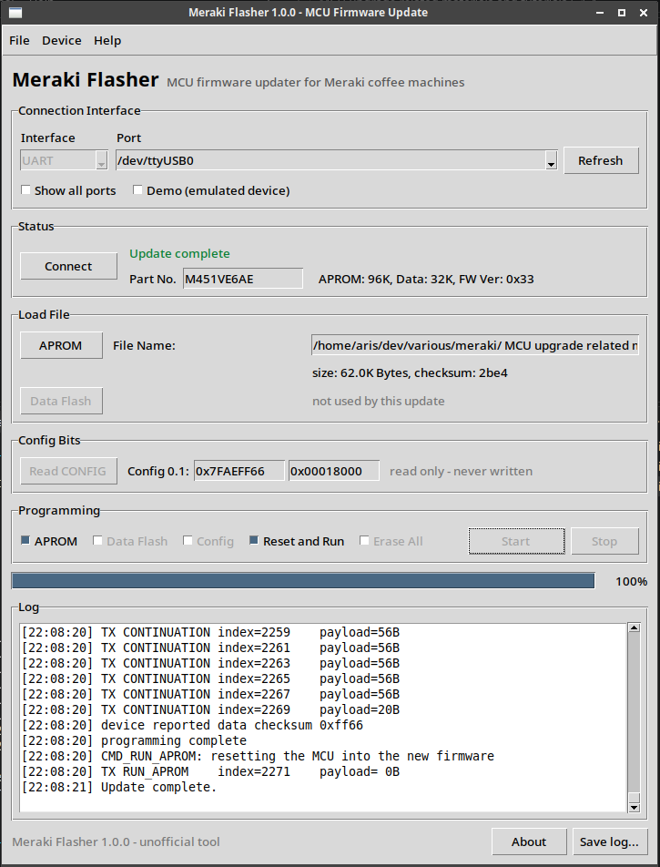

# Meraki Flasher

[](https://github.com/progtologist/meraki-flasher/actions/workflows/tests.yml)

**MCU firmware updater for Meraki coffee machines** — a native replacement for
the `NuvoISP.exe` + Windows-laptop procedure described in Meraki's
*Firmware Update Instruction*.

It talks the **Nuvoton NuMicro ISP (UART)** protocol directly over the Meraki
USB serial cable, so the update can be done from **Linux, macOS or Windows**
with no Wine and no Nuvoton software.



- **Byte-for-byte compatible with NuvoISP 4.13**: the same command sequence
  (`CMD_CONNECT` → `CMD_SYNC_PACKNO` → `CMD_GET_VERSION` → `CMD_GET_DEVICEID` →
  `CMD_READ_CONFIG` → `CMD_UPDATE_APROM` → `CMD_RUN_APROM`), the same packet
  numbering, timeouts and retry behaviour.
- **Verified on real hardware**: M451VE6AE, APROM 96 KiB / Data Flash 32 KiB,
  ISP firmware `0x33` — `MEM03_V514_260923.bin` was programmed and the machine
  booted the new version (screenshot above).
- **Writes the APROM only**: CONFIG bits, the LDROM bootloader and the Data Flash
  area holding the machine's settings (voltage, grind factors, UID, serial) are
  never touched — exactly like the vendor procedure, where *Erase All* and
  *Config* stay unchecked.

---

## Quick start

1. Install pyserial ([section 2](#2-install)) and plug in Meraki's USB serial
   cable — the port list fills itself in.
2. Start the GUI:
   `py -3 -m meraki_flasher` (Windows) · `python3 -m meraki_flasher` (macOS/Linux).
3. Choose the port → **Load File → APROM** → your `.bin` → **Connect** →
   **power-cycle the machine** → **Start** → *Update complete*.

Command-line equivalent, if you prefer:

```bash
python3 -m meraki_flasher.cli --file /path/to/firmware.bin    # then power-cycle
```

No Python on the machine you are updating from? Then use Meraki's original
`NuvoISP.exe` on Windows instead — this tool exists to make the same procedure
possible everywhere else.

---

## Contents

- [Quick start](#quick-start)
1. [What you need](#1-what-you-need)
2. [Install](#2-install)
3. [Flash it — GUI](#3-flash-it--gui)
4. [Flash it — command line](#4-flash-it--command-line)
5. [Which firmware file?](#5-which-firmware-file)
6. [Diagnostics](#6-diagnostics)
7. [Troubleshooting](#7-troubleshooting)
8. [Safety notes](#8-safety-notes)
9. [How it works](#9-how-it-works)
10. [Platform notes](#10-platform-notes)
11. [Development](#11-development)
12. [Licence and attribution](#12-licence-and-attribution)

---

## 1. What you need

- The coffee machine and its **mains power** (you will switch it off and on).
- Meraki's **USB serial cable** (the CH340/CH341-based one supplied with the
  update package). Any 3.3 V USB-TTL adapter wired to the machine's service
  connector works too.
- A computer with **Python 3.9 or newer** (Windows, macOS or Linux).
- The **firmware `.bin`** from Meraki's update package (see
  [section 5](#5-which-firmware-file)).
- Roughly two minutes. The transfer itself takes well under a minute.

No admin rights are needed beyond installing Python/pyserial and (on
Linux/macOS) the serial driver/permissions listed below.

---

## 2. Install

### 2.1 Python and pyserial

| OS | Install Python | Install pyserial |
|---|---|---|
| **Windows** | [python.org](https://www.python.org/downloads/windows/) — tick *Add python.exe to PATH* | `py -3 -m pip install pyserial` |
| **macOS** | [python.org](https://www.python.org/downloads/macos/) or `brew install python` | `python3 -m pip install --user pyserial` |
| **Linux** | already installed on most systems | `python3 -m pip install --user pyserial` |

The GUI uses `tkinter`, which ships with the python.org installers on Windows
and macOS. On macOS with Homebrew Python you may need
`brew install python-tk@3.12`; on Debian/Ubuntu `sudo apt install python3-tk`.

### 2.2 Serial driver / permissions

| OS | The adapter appears as | What to do |
|---|---|---|
| **Linux** | `/dev/ttyUSB0` | The kernel's `ch341` module handles CH340/CH341 automatically. Add yourself to the `dialout` group: `sudo usermod -aG dialout $USER`, then log out and back in. |
| **macOS** | `/dev/cu.usbserial-XXXX` | Install WCH's **CH34xVCPDriver** (macOS 11+ incl. Apple Silicon). The tool prefers `cu.*` over `tty.*`. |
| **Windows** | `COM3`, `COM4`, … | Install **CH341SER** (it is in Meraki's package as `CH341SER.EXE`) or let Windows Update find it. |

Use a **3.3 V** TTL adapter — the M451 is a 3.3 V part. Meraki's cable already
is.

### 2.3 Get the tool

```bash
cd meraki-flasher
```

Two ways to launch it (no build step, no installation required):

| | GUI | Command line |
|---|---|---|
| **Windows** | `py -3 -m meraki_flasher` | `py -3 -m meraki_flasher.cli --help` |
| **macOS / Linux** | `python3 -m meraki_flasher` | `python3 -m meraki_flasher.cli --help` |

Optional: `python3 -m pip install -e .` adds the `meraki-flasher` (GUI) and
`meraki-flasher-cli` commands to your PATH.

Check that the adapter is visible before you start:

```bash
python3 -m meraki_flasher.cli --list-ports
# /dev/ttyUSB0   USB   USB Serial  [USB VID:PID=1A86:7523 LOCATION=3-2]
# (Windows:  COM3  USB  USB-SERIAL CH340  [USB VID:PID=1A86:7523 ...])
```

---

## 3. Flash it — GUI

Launch the GUI (`py -3 -m meraki_flasher` on Windows, `python3 -m meraki_flasher`
elsewhere). The window mirrors the vendor tool, so the technician instructions
map one-to-one:

| Vendor instruction (NuvoISP) | Meraki Flasher |
|---|---|
| STEP 1–3 — open the package, run `NuvoISP.exe` | run the GUI (above) |
| STEP 4 — *UART* + *COMx*, click *Connect* | *Connection Interface*: **UART** is already selected; pick the port (it is auto-selected when only one adapter is present), click **Connect** |
| STEP 5/6 — *APROM*, choose the file for the machine's version | **Load File → APROM** → select the `.bin`; size and checksum appear underneath (identical to NuvoISP's) |
| STEP 7 — *APROM* + *Reset and Run* | both are checked by default; *Data Flash*, *Config* and *Erase All* are intentionally greyed out |
| STEP 8 — click *Connect* | **Connect** — status turns to *Waiting for device connection…* |
| STEP 9 — full power cycle | **switch the machine off and on now** — the LDROM bootloader only listens ~300 ms after reset, so the tool keeps polling until it answers |
| STEP 10 — click *Start* | **Start** — progress bar + packet log |
| STEP 11 — *Confirm* | an *Update complete* dialog appears (the reset-and-run command has already been sent) |
| STEP 13 — check the version | Settings → About → e.g. `V5.1.4` |

Notes:

* **Status colours**: red = not connected / working, green = connected or done.
  *Part No.*, `APROM: 96K  Data: 32K  FW Ver: 0x33` and the CONFIG words are read
  from the device when it connects (read-only).
* **Stop** aborts; the machine always recovers by power-cycling and re-running.
* **File → Save log…** stores the timestamped packet log — please attach it to
  any bug report.
* **Help → About** (or the *About* button) shows version, verified target,
  protocol compatibility and the runtime line (*Copy details* for support).
* **Demo (emulated device)** runs the whole flow against a built-in MCU
  emulator on a pseudo terminal — handy for training or trying the UI without a
  machine (Linux/macOS only, see `docs/demo-mode.png`).
* If the machine needs it, hold nothing, press nothing: the bootloader window is
  caught by the polling alone. Just make sure the power cycle happens **while
  the status says "Waiting for device connection"**.

---

## 4. Flash it — command line

```bash
# 0) sanity-check the file (no port access at all)
python3 -m meraki_flasher.cli --file ../MEM03_V514_260923.bin --dry-run

# 1) start this first, then power-cycle the machine while it runs
python3 -m meraki_flasher.cli --file ../MEM03_V514_260923.bin --port /dev/ttyUSB0
#    Windows:  py -3 -m meraki_flasher.cli --file ..\MEM03_V514_260923.bin --port COM3
```

Output looks like:

```
Meraki Flasher 1.0.0
file: ../MEM03_V514_260923.bin
size: 62.0K Bytes, checksum: 2be4
loaded ...  opened /dev/ttyUSB0 at 115200 8N1
waiting for the device (up to 60s) - power cycle it now
  waiting for the device:   4s left - power-cycle it now...
connected after 3 attempt(s), capability 0x00000000
detected M451VE6AE (PID 0x00845131)
APROM: 96K, Data: 32K, FW Ver: 0x33
  programming APROM: 100%  (63460/63460 bytes)
device reported its own data checksum 0xff66 (not the file checksum 2be4)
programming complete
CMD_RUN_APROM: resetting the MCU into the new firmware
done: M451VE6AE updated, APROM: 96K, Data: 32K, FW Ver: 0x33
```

Options:

| Option | Meaning |
|---|---|
| `--file/-f`, `--port/-p` | firmware and serial port (port is auto-detected when only one adapter exists) |
| `--baud` | default 115200 — do not change unless diagnostics says so |
| `--connect-timeout` | seconds to wait for the device (default 60) |
| `--no-reset` | program but do not run the new firmware |
| `--dry-run` | validate the image and count the ISP packets, without touching the port |
| `--verbose` / `--hexdump` | log every ISP command / every 64-byte packet |
| `--list-ports`, `--all-ports` | enumerate adapters (USB-only by default) |
| `--about`, `--version` | compatibility statement, version |

Exit codes: `0` success, `1` failure (message on stderr), `2` usage error,
`130` cancelled.

---

## 5. Which firmware file?

Take the `.bin` from the update package Meraki supplied for your machine. The
vendor instruction distinguishes machines by their currently installed version:

| Machine's current version | Vendor's file rule | Typical file |
|---|---|---|
| `V3.9.7` or lower | update to `V3.9.7G1` first | `*_V397G1_*.bin` |
| higher than `V3.9.7` | update to `V4.1.7G1` (or the current release) | `*_V417G1_*.bin` / `MEM03_V514_*.bin` |

Two safeguards before you press *Start*:

1. The GUI/CLI shows **size and checksum** of the file — the same two numbers
   NuvoISP displays for the same file (`size: 62.0K Bytes, checksum: 2be4`).
   If they differ, you are looking at a different file.
2. A file larger than the machine's APROM (96 KiB) is refused outright, and a
   file without a plausible Cortex-M vector table triggers a warning.

If you are unsure which package applies to your machine, ask Meraki
(`service@merakitech.com`) — flashing the wrong variant is recoverable, but you
will still need the right file afterwards.

---

## 6. Diagnostics

All four modes live in the CLI, need no firmware file, and are safe to run
(none of them writes to the machine).

```bash
python3 -m meraki_flasher.cli --list-ports          # what adapters exist
python3 -m meraki_flasher.cli --listen 5            # what does the machine say? (transmits nothing)
python3 -m meraki_flasher.cli --watch-reset 30      # does a power cycle reset the MCU?
python3 -m meraki_flasher.cli --probe --probe-seconds 8   # does the ISP bootloader answer?
python3 -m meraki_flasher.cli --loopback 5          # can the adapter transmit?
```

**`--listen`** — dumps every byte the machine sends. A healthy machine prints
one line per second from its application:

```
   25B     2026/10/30 21:56:35..
   25B     2026/10/30 21:56:36..
```

That 1 Hz heartbeat is normal. It is also why the tool purges the RX buffer
before each command and resynchronises on the ACK checksum, instead of assuming
"64 bytes = one packet".

**`--watch-reset`** — listens only and reports silences longer than 1.5 s, i.e.
reboots of the MCU. Run it and switch the machine off for ≥3 s while it runs:

```
  +  5.2s  MCU rebooted (3.6s of silence)
MCU resets detected: 1 (silences: 3.6s)
=> A power cycle does reach the MCU, so the LDROM ISP window does open.
```

If it reports `MCU resets detected: 0`, the switched supply does not feed the
MCU — pull the machine's mains plug (not just the front switch) for ≥10 s.

**`--probe`** — polls `CMD_CONNECT` at 115200/57600/38400/19200/9600 in turn and
reports any bytes received, a detected reboot, and whether a valid ISP ACK
appeared. Useful when you suspect the baud rate or the adapter.

**`--loopback`** — unplug the cable from the machine, connect the adapter's TX
and RX leads together, and run it: every byte must come straight back. `PASS`
proves the adapter and the software can transmit; `FAIL` points at the adapter,
its driver, or another program holding the port.

---

## 7. Troubleshooting

| Symptom | Cause / fix |
|---|---|
| `no USB serial adapter found` | cable not plugged in or driver missing. Check `--list-ports --all-ports`; on Linux `dmesg`/`journalctl -k` shows `ch341-uart converter now attached to ttyUSB0` |
| `cannot open … Permission denied` (Linux) | `sudo usermod -aG dialout $USER`, then log out and back in |
| `cannot open … Device or resource busy` | another program holds the port (a terminal, ModemManager, an earlier GUI). Close it |
| `cannot open … Access is denied` (Windows) | same cause; also check Device Manager that no other tool grabbed the COM port |
| `no device answered CMD_CONNECT within 60s` | the machine was not power-cycled **while the tool was polling**, or the cable is in the wrong connector, or the MCU is not powered. Run `--watch-reset 30` to see whether the power cycle reaches it |
| Probe shows the 1 Hz heartbeat but never an ISP ACK | the machine is booting straight into its application; check that the power cycle really resets it (`--watch-reset`) and that TX reaches the MCU (`--loopback`) |
| `the USB serial adapter is gone` mid-run | USB cable/port dropped the CH340. Try another port, avoid hubs. The port name may change (`ttyUSB1`), so re-run `--list-ports` |
| `programming failed at offset 0x000030` | flaky cable or level shifter — re-run; each chunk is already retried 10× |
| `image is … but APROM is only …` | wrong file for this machine (too big) — nothing was written |
| `unknown device ID 0x…` | different MCU revision; the APROM size is assumed to be 96 KiB. Please report the log |
| Update completes but the old version still shows | the machine was not power-cycled after `CMD_RUN_APROM`, or the wrong variant was flashed (section 5) |
| `python3: command not found` (macOS/Linux) | install Python 3.9+; on Windows use `py -3` |
| `ModuleNotFoundError: No module named 'serial'` | `python3 -m pip install --user pyserial` |
| `ModuleNotFoundError: tkinter` (GUI) | Debian/Ubuntu: `sudo apt install python3-tk`; macOS/Homebrew: `brew install python-tk@3.12` |

Every run can be logged (`--verbose` in the CLI, *File → Save log…* in the GUI);
that log is the most useful thing to send with a bug report.

---

## 8. Safety notes

* **Only the APROM is written.** `CMD_UPDATE_APROM` erases exactly the region
  covered by the image and programs it; the LDROM bootloader and the Data Flash
  area (voltage, grind factors, UID, serial number) are left alone.
* **CONFIG bits are never written** (`CMD_UPDATE_CONFIG` is not implemented).
  Bad CONFIG values can disable the ISP bootloader — the one way to make a board
  unrecoverable — so it is deliberately out of reach.
* **`CMD_ERASE_ALL` is not implemented** either; it would wipe CONFIG and the
  Data Flash settings and is never needed for a firmware update.
* **Wrong-size images are refused** before a single packet is sent, so a wrong
  file cannot spill into Data Flash.
* **Interrupting a flash is recoverable**: power-cycle the machine and run the
  update again. The bootloader is reached the same way every time.
* Keep the machine powered and the USB cable plugged in for the ~1 minute the
  transfer takes.

---

## 9. How it works

The ISP protocol is a fixed 64-byte packet protocol over 115200 8N1:

```
host -> device                    device -> host (ACK)
+--------+--------+----------+    +----------+---------+---------+----------+
| cmd u32| idx u32| payload  |    | cksum u16| rsvd u16| idx u32 | payload  |
+--------+--------+----------+    +----------+---------+---------+----------+
  bytes 0..3 4..7   8..63          bytes 0..1   2..3      4..7      8..63
```

* `cksum` is the 16-bit byte sum of the command packet; the ACK's `idx` must be
  the command's `idx` + 1, and the host advances its index by 2 per packet.
* APROM programming: the first packet carries start address, total length and 48
  data bytes; each following packet carries 56 data bytes with command `0`. The
  first packet also erases the region, hence its 25 s timeout.
* A chunk whose ACK is corrupt is repaired with `CMD_RESEND_PACKET` and resent
  (max 10 attempts).

### Wire-level parity with NuvoISP

Checked against the OpenNuvoton sources (tags v4.12 and v4.14, which bracket the
4.13 build shipped in Meraki's 5.1.4 package, plus master):

| Detail | Vendor (NuvoISP) | Meraki Flasher |
|---|---|---|
| Initial packet index | `m_uCmdIndex(18)` — *"Do not use 0 …"* | 18, +2 per write |
| `CMD_CONNECT` window | 40 ms at 115200, `2*640000/baud` above | same (`isp.connect_window()`) |
| After a successful connect | `ReOpen_Port()` (close/reopen → DTR re-asserted, buffers purged) | `transport.reopen()` |
| Before every write | `PurgeComm(PURGE_RXCLEAR)` | `write(purge_rx=True)` |
| APROM packets | addr+len+48 data, then 56-byte chunks | same |
| Commands | CONNECT, SYNC_PACKNO, GET_VERSION, GET_DEVICEID, READ_CONFIG, UPDATE_APROM, RESEND_PACKET, RUN_APROM | same set |

The one intentional improvement is the receive path: instead of assuming
"64 bytes = one packet", incoming data is scanned for a frame whose echoed
checksum and index match the command just sent, so the machine's 1 Hz console
output (or a power-on glitch) can never desynchronise a session.

### Code map

| Module | Role |
|---|---|
| `meraki_flasher/protocol.py` | framing, checksum, chunking |
| `meraki_flasher/isp.py` | command layer (port of `ISPLdCMD.cpp`) |
| `meraki_flasher/session.py` | connect → program → run, UI-agnostic |
| `meraki_flasher/transport.py` | pyserial wrapper, port discovery, frame resync |
| `meraki_flasher/chips.py` | PID → flash geometry (M451/M452 family) |
| `meraki_flasher/firmware.py` | image loading, checksum, size guard |
| `meraki_flasher/emulator.py` | protocol-accurate MCU emulator (tests + demo mode) |
| `meraki_flasher/diag.py` | `--listen`, `--probe`, `--watch-reset`, `--loopback` |
| `meraki_flasher/gui.py`, `cli.py` | front ends |
| `meraki_flasher/about.py` | About dialog / `--about` text |

---

## 10. Platform notes

| | Linux | macOS | Windows |
|---|---|---|---|
| GUI (Tkinter) | tested (X11) | should work (may need `python-tk`) | should work (python.org build includes Tk) |
| CLI | tested | should work | should work (`py -3`) |
| Serial driver | kernel `ch341`, built in | WCH CH34xVCPDriver | CH341SER (shipped in Meraki's package) |
| Port name | `/dev/ttyUSB0` | `/dev/cu.usbserial-XXXX` (preferred over `tty.*`) | `COM3`, `COM4`, … |
| Extra setup | `dialout` group | driver only | driver only |
| Demo mode (emulated device) | yes | yes | disabled (needs POSIX pseudo terminals) |
| pty-based tests | run | run | skipped automatically |

The flashing path contains no OS-specific calls: `pyserial` plus the standard
library only, with the POSIX-only pieces (`pty`) behind a runtime check. Port
discovery asks pyserial, so `COM3`, `/dev/cu.*` and `/dev/ttyUSB0` are all
handled the same way, and the CLI prints ASCII only (safe on legacy Windows
code pages).

**Honest status:** development and the verified run happened on Linux; macOS and
Windows support follows from the code structure but has not been exercised there
yet. On Windows, if the CH340 does not appear in `--list-ports`, check Device
Manager for a driver error first.

---

## 11. Development

```bash
cd meraki-flasher
python3 -m unittest discover -s tests -t . -v
```

37 tests, about 9 s. They flash a firmware image into the emulated MCU over a
pseudo terminal and assert the resulting image is byte-identical; they also pin
the wire format (initial index 18, +2 per packet, 40 ms connect window,
reopen-after-connect, 48/56-byte chunks), the resend/retry path, a device that
boots late, application chatter on the line, the oversize-file guard, and the
reset watchdog.

Meraki's firmware is **not** part of this repository, so the suite falls back to
a synthetic image of exactly the same size (63 460 bytes → the same 1134
packets). To run the extra checks against the real file:

```bash
MERAKI_FIRMWARE=/path/to/MEM03_V514_260923.bin python3 -m unittest discover -s tests -t .
# MERAKI_FIRMWARE=none forces the synthetic fixture
```

CI (`.github/workflows/tests.yml`) runs the same suite on Ubuntu 24.04 (Python
3.9 and 3.13), macOS (3.13) and Windows (3.9 and 3.13), plus a `ruff check` job.
The pty-based tests skip themselves on Windows; macOS and Linux run all of them.
(`ubuntu-latest` moved to Ubuntu 26.04, which has no 3.9 build, and the macOS
runners are arm64 — hence the explicit cells.)

```
tests/test_protocol.py   framing, checksum, chunk layout
tests/test_isp.py        vendor-compatible packet numbering and connect flow
tests/test_firmware.py   image metadata and guards
tests/test_session.py    end-to-end flash, retries, error paths (pty)
tests/test_diag.py       reset watchdog, port-presence helper
```

`tests/support.py` holds the pty harness, the firmware discovery rules above and
the synthetic-image generator.

The emulator (`meraki_flasher/emulator.py`) is a faithful ISP device: it honours
packet indices, returns checksums, and can inject corrupt ACKs, delay power-up or
prefix the link with application chatter — add a flag there to reproduce a field
problem in a test.

---

## 12. Licence and attribution

Apache License 2.0 — see `LICENSE` and `NOTICE`.

The command layer is a Python port of **OpenNuvoton/ISPTool** (the NuvoISP
project), Copyright 2025 Nuvoton Technology Corporation, Apache-2.0. This is an
independent, unofficial tool: it is not affiliated with, authorised or endorsed
by Nuvoton Technology Corporation or Merakitech. Flashing is at your own risk.

**Verified**: 2026-10-30 — Meraki coffee machine with M451VE6AE / ISP firmware
`0x33`, file `MEM03_V514_260923.bin` (62.0K Bytes, checksum `2be4`) programmed
and reset successfully; the screenshot at the top of this document is that run.


